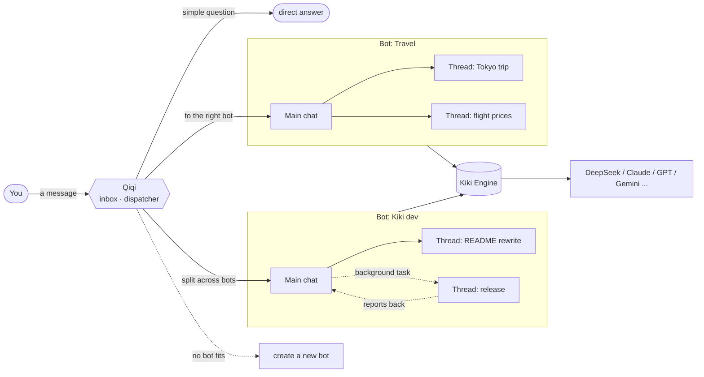

<div align="center">

[简体中文](README.md) · **English**

<picture>
  <source media="(prefers-color-scheme: dark)" srcset="docs/assets/banner-en-dark.svg">
  
</picture>

<p>
  <a href="https://github.com/lkyxuan/kiki/stargazers"></a>
  <a href="https://github.com/lkyxuan/kiki/releases"></a>
  <a href="LICENSE"></a>
  
  
  
</p>

**Tell Qiqi once, and it hands the job to the right bot. Each bot owns one area of your life, each task gets its own thread, and your data never leaves your Mac.**

[Download](#-download) · [Features](#-features) · [How to use](#-how-to-use) · [Architecture](#️-architecture) · [Roadmap](#️-roadmap) · [Contributing](#-contributing)

</div>

---

## 📖 Overview

**Kiki** is an open-source, local-first personal AI assistant built for an always-on Mac mini and packaged as a native Mac app.

You only ever talk to **Qiqi** (奇奇), your inbox. Quick questions get answered on the spot. Real work goes to the **bot** (宝, *bao*) that owns that area. A message that mixes several things gets split across several bots, and if no bot fits, Qiqi creates one. Every bot has a **main chat** that coordinates its work and opens **threads** for individual tasks, so contexts never get tangled.

Unlike cloud assistants, Kiki runs on your own computer. You choose the model, conversations are local files, and your "about me" profile and each bot's instructions are plain Markdown. If you ever stop using Kiki, just take the folder with you.

<div align="center">
  <picture>
    <source media="(prefers-color-scheme: dark)" srcset="docs/assets/screenshot-dark.png">
    
  </picture>
  <p><sub>Four columns: Qiqi and your bots on the left, the bot's main chat in the middle, a thread on the right, and the bot's status at the far right. (UI is in Chinese for now.)</sub></p>
</div>

## ✨ Features

| | Feature | Description |
|:---:|---|---|
| 📥 | **Qiqi only dispatches** | Drop in a message and Qiqi picks the bot and the conversation. Simple questions get a direct answer; mixed requests get split up |
| 🤖 | **One bot per area** | Travel, dev, fitness… each bot has an avatar, a main chat and its own instructions. Creating one takes a name and a sentence on what it handles |
| 💬 | **Main chat + threads** | A bot's main chat coordinates; concrete tasks become threads. Conversation cards open in the side column, where you can keep talking |
| ⚡ | **Chat in front, work in back** | Hand real work to the background and get the result back in the original conversation. Tasks queue, can be retried, and survive restarts |
| 🧠 | **Bots that keep track** | Every conversation has a one-line summary. Bots can read other conversations, pass messages between them, and save key facts to "about me" |
| 🛡️ | **Asks before acting** | Four kinds of irreversible actions (permanent deletes, force pushes, sending things out, spending money) need your OK first |
| 🖼️ | **Images and any model** | Paste or drop images. Switch models right from the input box, with API keys or subscription logins (ChatGPT, Claude, GitHub Copilot and more) |
| 🔒 | **Local first** | Listens only on localhost, with encrypted remote access through Tailscale. Conversations are JSONL, notes are Markdown, and deleted items go to a trash folder |
| 🧩 | **Extensible** | Compatible with the pi extension ecosystem; add MCP servers in Settings using the same format as Claude and Cursor |

## 📦 Download

Recommended setup: run Kiki on an always-on Mac mini and use it from your MacBook or iPhone. Requires macOS 12 or later.

**Option 1: one line in Terminal**

```bash
curl -fsSL https://raw.githubusercontent.com/lkyxuan/kiki/main/packaging/install.sh | bash
```

**Option 2: download the installer**

Grab the `.dmg` from the [releases page](https://github.com/lkyxuan/kiki/releases/latest) (arm64 for Apple silicon, x64 for Intel) and drag Kiki into Applications.

Open Kiki, follow the prompt to add a model key in Settings, and start chatting.

- **Works out of the box**: Kiki.app bundles its own runtime and the Kiki Engine, starts in the background at login, and restarts itself if it crashes.
- **Automatic updates**: checks for new versions every hour, installs when idle, and rolls back automatically if the new version fails to start.
- **Multiple devices**: install Kiki.app on another Mac and choose "connect to a remote address" to use it as a front end only; on iPhone, add it to your Home Screen from Safari.
- **Secure remote access**: Kiki listens only on localhost. Remote access goes through an encrypted [Tailscale](https://tailscale.com) connection, so only your own devices can reach it.

See the **[Mac App guide](docs/mac-app.md)** (Chinese) for details.

## 💡 How to use

1. **Talk to Qiqi**, for example "I want to spend 5 days in Tokyo in December." Qiqi hands it to the Travel bot (creating it if needed), and you continue in Travel's main chat.
2. **Pick a bot yourself** with `@botname`.
3. **Open a thread** with the **+** next to a bot, or let the bot spin a new topic off into a thread. Threads open in the side column; close one to return to the overview.
4. **Manage bots** with the gear next to each bot: rename it, change its avatar and what it handles. Dispatch rules live in `~/kiki-data/分派规则.md` and can be edited anytime.

<details>
<summary><b>Commands</b></summary>

| Command | What it does |
|---|---|
| `@bot <message>` | Send straight to a bot |
| `/new <bot> <name>` | Start a new thread under a bot |
| `/use <name>` | Switch to an existing conversation (use `bot/name` if names collide) |
| `/list [bot]` | List all conversations, or those of one bot |
| `/bg <task>` | Run a task in the background; the result is reported back to the original conversation |
| `/tasks [all]` | List background tasks |
| `/retry <task id>` | Retry a failed or interrupted task |
| `/agents` | List all bots |
| `/where` | Show the current conversation |
| `/help` | Help |

</details>

## 🏗️ Architecture



**Three levels of dispatch**

1. **Qiqi**: deliberately thin. It triages and forwards but never takes on work itself, using each bot's description and each conversation's one-line summary to decide.
2. **Bots**: a folder under `~/kiki-data/agents/<bot>/` whose `AGENTS.md` states what the bot handles and how it works. Every bot has one fixed main chat.
3. **Threads**: individual conversations under a bot, stored locally as JSONL: readable, backup-friendly and portable.

## 📂 Data directory

```text
~/kiki-data/
├── AGENTS.md              # About me: shared by all bots
├── 分派规则.md             # Dispatch rules, editable anytime, no restart needed
├── .env                   # Model keys and config (readable only by you)
├── registry.json          # Conversation registry and one-line summaries
├── tasks/                 # Background tasks: one .md per task
├── trash/                 # Deleted threads end up here instead of being erased
├── engine/                # Kiki Engine extensions and MCP config
└── agents/
    ├── 奇奇/               # Qiqi, the default dispatcher bot
    └── 旅行/               # e.g. a Travel bot
        ├── AGENTS.md      # What it handles and how it works
        └── sessions/      # Main chat and threads (JSONL)
```

We recommend backing up `~/kiki-data` with Time Machine or a private Git repository.

## 🗺️ Roadmap

- [x] Qiqi dispatch: pick a bot, create bots, split one message across bots
- [x] Bot main chats + threads, four-column layout
- [x] Background tasks: queueing, retries, reporting back
- [x] Conversation summaries, cross-conversation messages, handoffs
- [x] Approvals for irreversible actions
- [x] Images, manual model picker, subscription logins
- [x] Mac App: one-line install, `.dmg`, automatic updates, launch animation
- [x] Secure remote access via Tailscale; several devices sharing one back end
- [ ] To-dos, scheduled tasks and a task board *(in progress)*
- [ ] Mailroom: connect external agents and messaging channels *(in progress)*
- [ ] Apple code signing and notarization

## 🚀 Run from source

To contribute, follow these steps. Requires [Node.js](https://nodejs.org) 22.19 or later.

```bash
git clone https://github.com/lkyxuan/kiki.git ~/kiki
cd ~/kiki
npm install
cp .env.example .env     # add a model API key, or set it later in Settings
npm start
```

Open **<http://localhost:4567>** and start chatting.

<details>
<summary><b>Configuration</b></summary>

These live in `~/kiki-data/.env` (or `.env` in the repo when running from source); most can also be changed in Settings.

| Variable | Default | Description |
|---|---|---|
| `DEEPSEEK_API_KEY` | — | DeepSeek key; configure other providers in Settings |
| `MODEL` | `deepseek/deepseek-flash` | Default model, as `provider/model` |
| `SUMMARY_MODEL` | same as `MODEL` | Model for summaries and dispatch; a cheaper one works well |
| `VISION_MODEL` | auto | Reads images when the current model can't |
| `DATA_DIR` | `~/kiki-data` | Data directory |
| `DEFAULT_AGENT` | `奇奇` | Bot that receives messages when no conversation is selected |
| `PORT` | `4567` | Web UI port |
| `TASK_CONCURRENCY` | `2` | Max background tasks running at once |
| `TASK_TIMEOUT_MIN` | `30` | Timeout per background task, in minutes |
| `KIKI_AUTO_UPDATE` | `1` | Set to `0` to only notify about updates instead of installing them |

</details>

<details>
<summary><b>Extensions and MCP</b></summary>

The Kiki Engine is compatible with the pi extension ecosystem. Extensions are installed in `~/kiki-data/engine`, separate from any pi you installed yourself. Install them under Settings → Extensions, or from the repo:

```bash
npm run pi -- install npm:pi-web-access   # web search and page reading
npm run pi -- list                        # list installed extensions
```

Add MCP servers under Settings → MCP Servers, using the same `mcpServers` format as Claude and Cursor.

</details>

<details>
<summary><b>Tech stack and project structure</b></summary>

| Layer | Choice |
|---|---|
| Agent engine | Kiki Engine, built on the open-source [pi](https://pi.dev) 1.4.0 |
| Language and runtime | TypeScript · Node.js 22 |
| UI | Local web app (SSE streaming), packaged as a Mac App |
| Storage | Local files: Markdown + JSONL, no database |

```text
src/
├── main.ts       # Entry: config, web UI, router and engine
├── server.ts     # Local web UI and API
├── router.ts     # Qiqi: dispatch, commands, forwarding
├── route.ts      # Auto-dispatch decision logic
├── agents.ts     # Engine wrapper: create/resume conversations, stream events
├── tasks.ts      # Background tasks
├── summary.ts    # Conversation summaries
├── tools.ts      # Bot tools: read other conversations, pass messages, save notes
├── approval.ts   # Approvals
├── update.ts     # Automatic updates
└── ...
public/           # Chat UI, settings, launch animation
packaging/        # Mac App packaging and install scripts
```

```bash
npm test          # run tests
npm run check     # type check
```

</details>

## 🤝 Contributing

Issues and pull requests are welcome.

1. Fork the repo and create a branch: `git checkout -b feat/your-feature`
2. Run `npm test` and `npm run check` before committing
3. Open a pull request with a short description of the change and why

## 🙏 Acknowledgements

- [pi](https://pi.dev): the open-source agent framework the Kiki Engine is built on
- OpenClaw: inspiration for background tasks and cross-conversation tools
- Hermes: inspiration for automatic updates and image reading
- Grok Bot: inspiration for the interaction model

## 📄 License

Kiki is open source under the [MIT License](LICENSE).

## ⭐ Star History

<a href="https://star-history.com/#lkyxuan/kiki&Date">
  <picture>
    <source media="(prefers-color-scheme: dark)" srcset="https://api.star-history.com/svg?repos=lkyxuan/kiki&type=Date&theme=dark">
    
  </picture>
</a>

<div align="center">

If Kiki is useful to you, please give it a ⭐!

</div>
