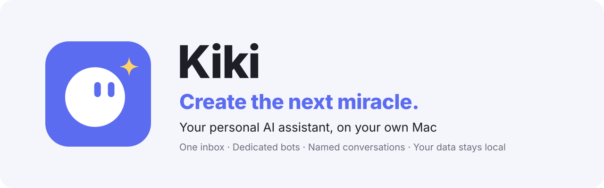
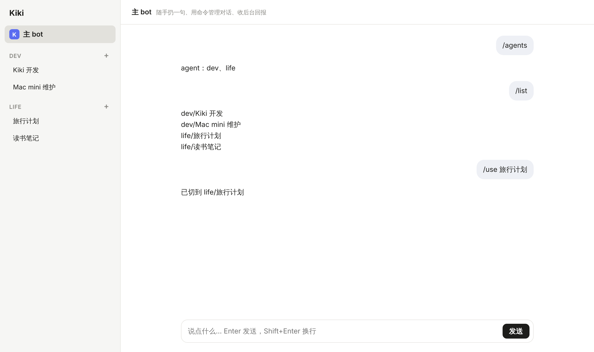
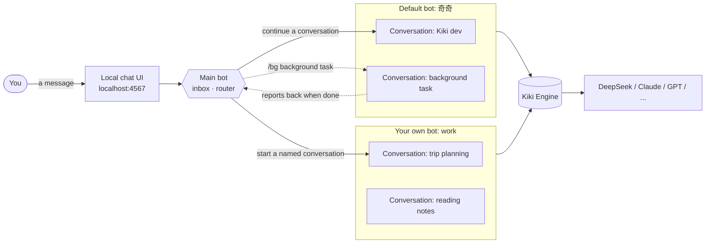

<div align="center">

[简体中文](README.md) · **English**

<picture>
  <source media="(prefers-color-scheme: dark)" srcset="docs/assets/banner-en-dark.svg">
  
</picture>

<p>
  <a href="https://github.com/lkyxuan/kiki/stargazers"></a>
  <a href="https://github.com/lkyxuan/kiki/releases"></a>
  <a href="LICENSE"></a>
  
  
  
</p>

**One inbox. Dedicated bots. Unlimited named conversations. Your data never leaves your machine.**

[Install the Mac App](#-install-the-mac-app) · [Quick Start](#-quick-start) · [Features](#-features) · [Architecture](#️-architecture) · [Roadmap](#️-roadmap) · [Contributing](#-contributing)

</div>

---

## 📖 Overview

**Kiki** is an open-source, local-first personal AI assistant built for an always-on Mac mini. Inspired by Grok Bot, you talk to a single **main bot** that works like an inbox: it routes each request to the right **dedicated bot**, and every dedicated bot keeps its own set of **named conversations**, organized by topic.

Unlike cloud assistants, Kiki runs on your own computer. You pick the model, conversations are local files, and your "about me" profile and notes are plain Markdown. If you ever stop using Kiki, just take the folder with you.

The Kiki Engine creates and resumes conversations and calls models and tools. It is lightweight, extensible, and version-locked with every Kiki release.

> [!NOTE]
> Kiki is in early development. A one-line-install Mac App with automatic updates is already available. Star the repo to follow along.

## ✨ Features

| | Feature | Description |
|:---:|---|---|
| 📥 | **Main bot as your inbox** | Drop in a message and the main bot only triages and forwards. All real work goes to dedicated bots |
| 🤖 | **Dedicated bots** | Dev, life, study… each bot is a folder with one `AGENTS.md`. Add a bot without code changes or restarts |
| 💬 | **Named conversations** | Open as many named conversations per bot as you like. Switch and resume anytime, with isolated context |
| ⚡ | **Chat in front, work in back** | Discuss right in the conversation; hand real work to the background with `/bg` and get the result back when it's done |
| 🔒 | **Local first** | The web UI listens only on `127.0.0.1`. Conversations are JSONL, notes are Markdown, all on your own disk |
| 🔌 | **Bring your own model** | DeepSeek by default; switch to Anthropic, OpenAI, Google and other major models with one line of config |
| 🧩 | **A replaceable shell** | Orchestration is fully separated from your data. UI, channels and models are all swappable, with no vendor lock-in |

## 🖼️ Screenshot

<div align="center">
  
  <p><sub>Main bot and dedicated bots with their conversations on the left, chat on the right, with streaming replies.</sub></p>
</div>

## 🏗️ Architecture



**Three layers**

1. **Main bot**: deliberately thin. It decides whether a message continues an existing conversation or starts a new one under some bot, then relays the result back to you.
2. **Dedicated bots**: a folder under `~/kiki-data/agents/<name>/`, whose `AGENTS.md` states what the bot is responsible for, how it works and what it hands back.
3. **Named conversations**: sessions under a bot, stored locally as JSONL: readable, backup-friendly and portable.

## 🍎 Install the Mac App

Recommended setup: run Kiki on an always-on Mac mini and use it remotely from your MacBook or iPhone. Run one line in Terminal on the Mac mini:

```bash
curl -fsSL https://raw.githubusercontent.com/lkyxuan/kiki/main/packaging/install.sh | bash
```

- **Works out of the box**: Kiki.app bundles its own runtime and the Kiki Engine, so there's no Node to install. It starts in the background at login and restarts automatically if it crashes.
- **Automatic updates**: a prompt appears in the top-right corner of the web UI when a new version is out. By default it installs while no conversation is running, and rolls back automatically if anything fails.
- **Secure remote access**: Kiki listens only on localhost. Remote access goes through an encrypted [Tailscale](https://tailscale.com) connection, so only your own devices can reach it.

After installing, add your model API key to `~/kiki-data/.env`, then restart Kiki: `launchctl kickstart -k gui/$(id -u)/com.lkyxuan.kiki`. See the **[Mac App guide](docs/mac-app.md)** (Chinese) for full install, update, remote access and uninstall instructions.

## 🚀 Quick Start

To run from source or contribute, follow these steps.

### Requirements

- macOS (an always-on Mac mini is recommended)
- [Node.js](https://nodejs.org) 22.19 or later: `brew install node`
- A model API key ([DeepSeek](https://platform.deepseek.com) by default)

### Install and run

```bash
git clone https://github.com/lkyxuan/kiki.git ~/kiki
cd ~/kiki
npm install
cp .env.example .env     # add your model API key
npm start
```

Open **<http://localhost:4567>** and start chatting.

On first launch Kiki creates a data directory at `~/kiki-data` with one default bot, 奇奇 (Qiqi); new bots branch off from it later. Start by editing its `AGENTS.md` with what you want every bot to know about you.

> The Kiki Engine is installed with `npm install`; no separate install is needed. It is also bundled into `.app` when packaged as a Mac App, and engine upgrades ship with Kiki releases after testing.

### Configuration

| Variable | Default | Description |
|---|---|---|
| `DEEPSEEK_API_KEY` | — | Model API key |
| `MODEL` | `deepseek/deepseek-flash` | Model, as `provider/model` |
| `DATA_DIR` | `~/kiki-data` | Data directory |
| `DEFAULT_AGENT` | `奇奇` | Bot that receives messages when no conversation is selected |
| `PORT` | `4567` | Web UI port |

## 💡 Usage

Click any conversation on the left to chat; click **+** next to a bot name to start a new one. The main bot also understands commands:

| Command | What it does |
|---|---|
| `/new <bot> <name>` | Start a named conversation under a bot and switch to it |
| `/use <name>` | Switch to an existing conversation (use `bot/name` if names collide) |
| `/list [bot]` | List all conversations, or those of one bot |
| `/bg <task>` | Run a task in a new background conversation under the current bot; the result is reported back |
| `/agents` | List all bots |
| `/where` | Show the current conversation |
| `/help` | Help |

### Add a dedicated bot

```bash
mkdir -p ~/kiki-data/agents/study
$EDITOR ~/kiki-data/agents/study/AGENTS.md   # what it handles, how it works, what it returns
```

Refresh the page and the new bot appears. No restart needed.

## 📂 Data directory

```text
~/kiki-data/
├── AGENTS.md              # About me: shared by all bots
├── registry.json          # Conversation registry: named conversations and their bots
├── main.jsonl             # Main bot inbox history
└── agents/
    ├── 奇奇/              # the default bot
    │   ├── AGENTS.md      # its responsibilities
    │   └── sessions/      # its conversations (JSONL)
    └── work/              # a bot you created
        └── ...
```

We recommend backing up `~/kiki-data` with Time Machine or a private Git repository.

## 🧩 Recommended extensions

The Kiki Engine is compatible with the pi extension ecosystem. Installing extensions requires the pi CLI:

```bash
npm install -g @earendil-works/pi-coding-agent@1.4.0
```

| Extension | What it does | Install |
|---|---|---|
| [pi-web-access](https://www.npmjs.com/package/pi-web-access) | Web search and reading web pages, PDFs and GitHub repos | `pi install npm:pi-web-access` |
| [cc-safety-net](https://ccsafetynet.com/docs/installation/pi) | Blocks destructive commands like `rm -rf` and reads of secret files | See the [official guide](https://ccsafetynet.com/docs/installation/pi) |

> [!WARNING]
> Bots can read and write files and run commands, with real permissions on your computer. Installing cc-safety-net is strongly recommended.

## 🗺️ Roadmap

- [x] Kiki Engine: multiple bots, multiple named conversations
- [x] Background tasks with result reporting
- [x] Local chat UI (streaming)
- [x] Mac App: one-line install, start at login, automatic updates
- [x] Secure remote access via Tailscale
- [ ] Automatic routing in the main bot, using a lightweight model to pick the conversation
- [ ] Built-in Kiki extensions (`extensions/`)
- [ ] Messaging channel plugin interface (WeChat and more)
- [ ] Scheduled tasks

## 🛠️ Tech stack

| Layer | Choice |
|---|---|
| Agent engine | Kiki Engine, built on the open-source [pi](https://pi.dev) 1.4.0 |
| Language and runtime | TypeScript · Node.js 22 |
| UI | Local web app (SSE streaming), packaged as a Mac App |
| Storage | Local files: Markdown + JSONL, no database |

<details>
<summary><b>Project structure</b></summary>

```text
src/
├── main.ts       # Entry: reads config, wires up the web UI, router and engine
├── server.ts     # Local web UI and API; also the boundary for future channels
├── router.ts     # Main bot: command parsing and dispatch
├── registry.ts   # Conversation registry
└── agents.ts     # Engine wrapper: create/resume conversations, stream events, read history
public/
└── index.html    # Chat UI
```

```bash
npm test          # run tests
npm run check     # type check
```

</details>

## 🤝 Contributing

Issues and pull requests are welcome.

1. Fork the repo and create a branch: `git checkout -b feat/your-feature`
2. Run `npm test` and `npm run check` before committing
3. Open a pull request with a short description of the change and why

## 🙏 Acknowledgements

Kiki stands on the shoulders of many great projects. Thanks to the personal and coding agents below, whose open-source code, product ideas and public writing inspired Kiki.

**What Kiki builds on directly**

- [pi](https://pi.dev) ([pi-mono](https://github.com/badlogic/pi-mono)): the open-source agent framework the Kiki Engine is built on
- [DeepSeek](https://www.deepseek.com): the default model Kiki uses
- [cua](https://github.com/trycua/cua): open-source infrastructure for Computer-Use Agents, behind the cua-driver toggle

**Personal agents and agent gateways**

- [OpenClaw](https://github.com/openclaw/openclaw): a local-first personal AI assistant; inspiration for the session tool design
- [Hermes Agent](https://github.com/NousResearch/hermes-agent): Nous Research's self-improving personal agent, where Kiki's journey started
- Grok Bot: inspiration for the interaction model
- [Letta](https://github.com/letta-ai/letta) (formerly MemGPT): stateful agents with long-term memory
- [Open Interpreter](https://github.com/openinterpreter/open-interpreter): lets LLMs run code and operate your computer locally
- [AutoGPT](https://github.com/Significant-Gravitas/AutoGPT): an early pioneer of autonomous agents
- [Manus](https://manus.im): a general-purpose autonomous agent
- [browser-use](https://github.com/browser-use/browser-use): lets agents drive a web browser

**Coding agents**

- [Claude Code](https://github.com/anthropics/claude-code): Anthropic's agentic coding tool for the terminal
- [Codex](https://github.com/openai/codex): OpenAI's open-source coding agent for the terminal
- [Gemini CLI](https://github.com/google-gemini/gemini-cli): Google's open-source terminal agent
- [Qwen Code](https://github.com/QwenLM/qwen-code): Qwen's terminal coding agent
- [Kimi CLI](https://github.com/MoonshotAI/kimi-cli): Moonshot AI's terminal agent
- [opencode](https://github.com/sst/opencode): an open-source, model-agnostic terminal coding agent
- [Crush](https://github.com/charmbracelet/crush): Charm's terminal coding agent
- [Aider](https://github.com/Aider-AI/aider): git-native AI pair programming in the terminal
- [Goose](https://github.com/block/goose): Block's open-source, extensible local agent
- [OpenHands](https://github.com/All-Hands-AI/OpenHands): an open platform for AI software engineers
- [SWE-agent](https://github.com/SWE-agent/SWE-agent): a research agent that fixes GitHub issues automatically
- [Cline](https://github.com/cline/cline): an autonomous coding agent in VS Code with step-by-step approval
- [Roo Code](https://github.com/RooCodeInc/Roo-Code): an in-editor agent with multiple role modes
- [Kilo Code](https://github.com/Kilo-Org/kilocode): an open-source in-editor coding agent
- [Continue](https://github.com/continuedev/continue): an open-source IDE coding assistant
- [Cursor](https://cursor.com), [Windsurf](https://windsurf.com), [Zed](https://zed.dev), [Amp](https://ampcode.com), [Devin](https://devin.ai), [GitHub Copilot](https://github.com/features/copilot): products that brought agents into everyday development

**Open standards**

- [Model Context Protocol](https://modelcontextprotocol.io): an open protocol for connecting agents to tools and data
- [AGENTS.md](https://agents.md): a convention for project instructions aimed at agents, which every 宝's AGENTS.md follows

All project names and trademarks belong to their respective owners. They are listed here only as thanks and do not imply any partnership or endorsement.

## 📄 License

Kiki is open source under the [MIT License](LICENSE).

## ⭐ Star History

<a href="https://star-history.com/#lkyxuan/kiki&Date">
  <picture>
    <source media="(prefers-color-scheme: dark)" srcset="https://api.star-history.com/svg?repos=lkyxuan/kiki&type=Date&theme=dark">
    
  </picture>
</a>

<div align="center">

If Kiki is useful to you, please give it a ⭐!

</div>
