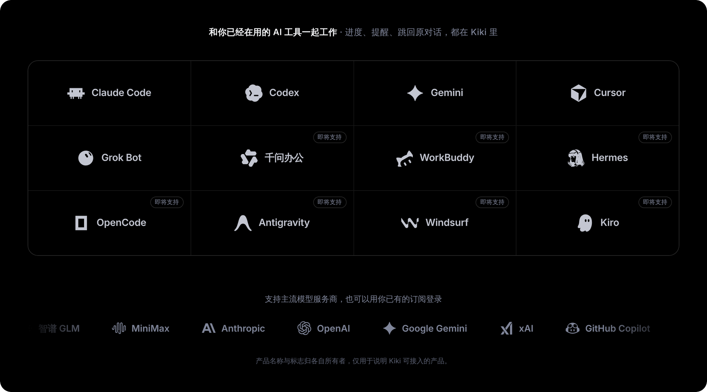
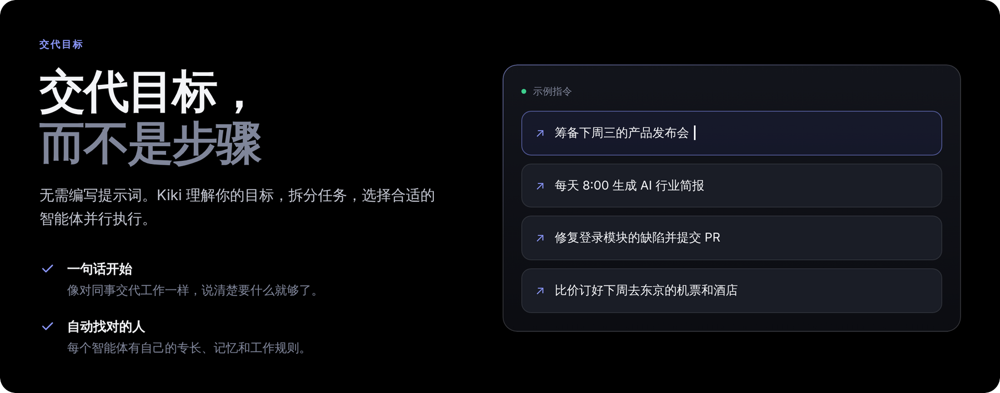
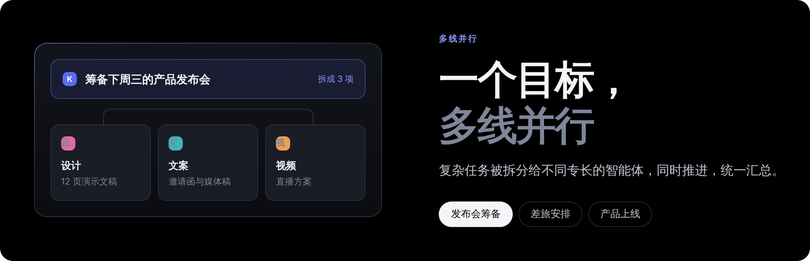
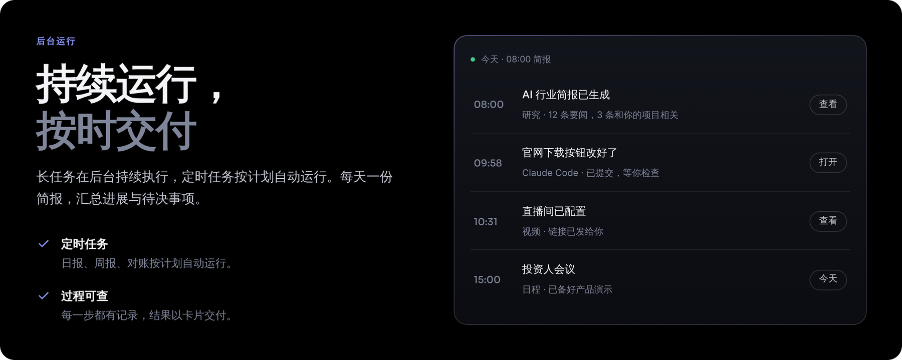
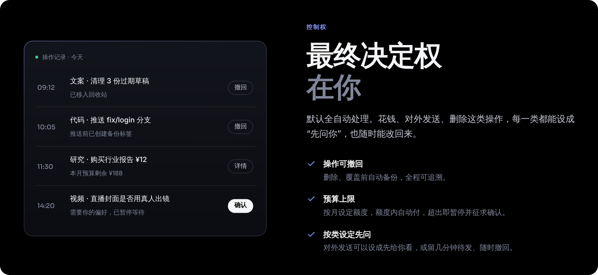
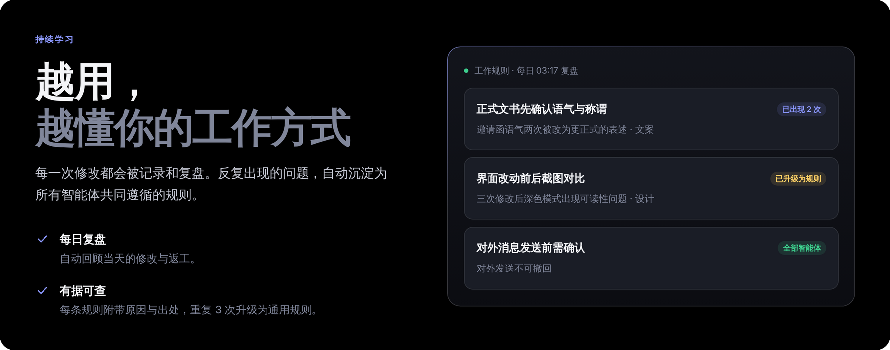
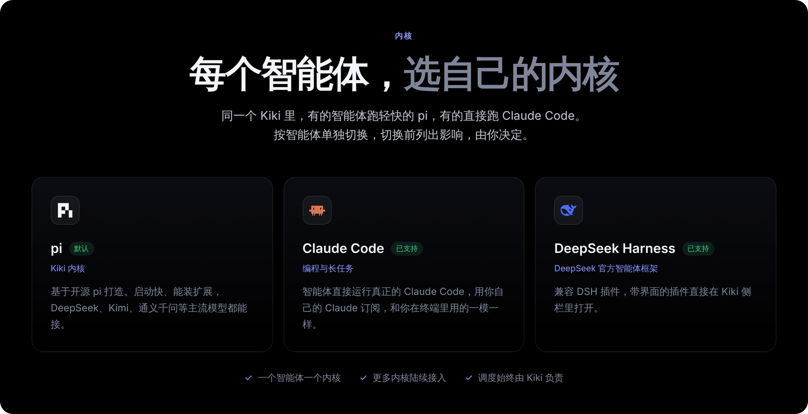
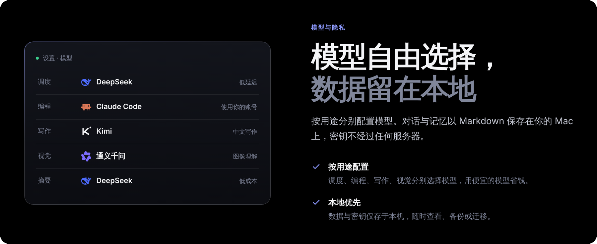
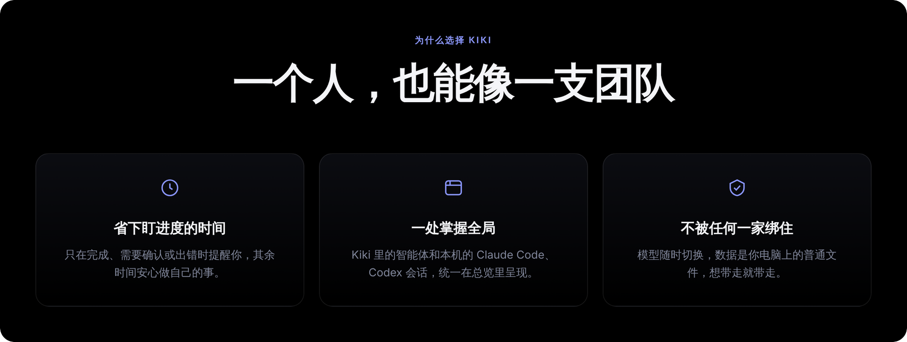
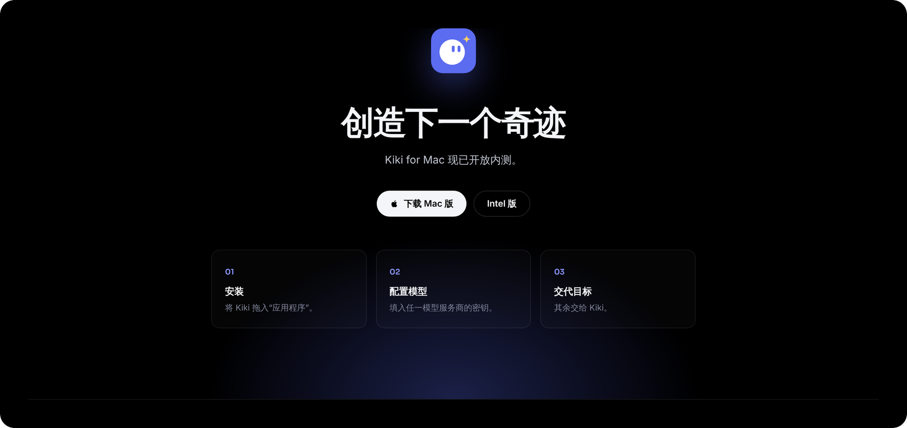

<div align="center">

**简体中文** · [English](README.en.md)

<br>

<a href="https://kikibao.com"></a>

<br><br>

<a href="https://dl.kikibao.com/latest/Kiki-mac-arm64.dmg"></a>
&nbsp;
<a href="https://dl.kikibao.com/latest/Kiki-mac-x64.dmg"></a>

<p>
  <a href="https://github.com/lkyxuan/kiki/releases/latest"></a>
  
  
  <a href="https://kikibao.com"></a>
</p>

</div>

<br>

<p align="center"></p>

<p align="center"></p>

<p align="center"></p>

<p align="center"></p>

<p align="center"></p>

<p align="center"></p>

<p align="center"></p>

<p align="center"></p>

<p align="center"></p>

<p align="center"><a href="https://dl.kikibao.com/latest/Kiki-mac-arm64.dmg"></a></p>

## 开始使用

1. **安装**：下载 [Apple 芯片版](https://dl.kikibao.com/latest/Kiki-mac-arm64.dmg) 或 [Intel 版](https://dl.kikibao.com/latest/Kiki-mac-x64.dmg)，把 Kiki 拖进「应用程序」，从「应用程序」里打开。需要 macOS 13.5 及以上。
2. **填邀请码**：内测名额分批开放，第一次打开时输入邀请码。
3. **配置模型**：填入任一模型服务商的密钥，或用订阅登录。
4. **交代目标**：其余交给 Kiki。

也可以在终端里一行安装最新版：

```bash
curl -fsSL https://raw.githubusercontent.com/lkyxuan/kiki/main/packaging/install.sh | bash
```

Kiki 会自己更新，新版起不来会自动回滚。第一次打开如果提示“无法验证开发者”，到「系统设置 → 隐私与安全性」点「仍要打开」。

## 常见问题

**费用怎么计算？** 模型费用由你自己的模型服务商账号直接结算，Kiki 不经手。以 DeepSeek 为例，日常使用每月花费很低。

**我的数据存在哪里？** 对话、记忆与配置以 Markdown 文件保存在你的 Mac 上，模型密钥仅存于本机。

**能和 Claude Code、Codex 一起用吗？** 可以。本机的会话会自动出现在 Kiki 的总览里，做完、需要你确认或出错时提醒你。

更多问题见 [官网](https://kikibao.com/#faq)。

## 更新日志与反馈

每个版本改了什么，写在 [Releases](https://github.com/lkyxuan/kiki/releases) 里。遇到问题或者想要什么功能，到 [Issues](https://github.com/lkyxuan/kiki/issues) 提。

---

<sub>这个仓库用来发布 Kiki 安装包和收集反馈。Kiki 不开放源代码；之前在这里公开过的代码仍按当时的许可证使用，可以在提交历史里找到。“Kiki”“奇奇”名称和 Kiki 图标是商标，经过签名的 Kiki 安装包只由官方发布。图中出现的产品名称与标志归各自所有者，仅用于说明 Kiki 可接入的产品。</sub>
