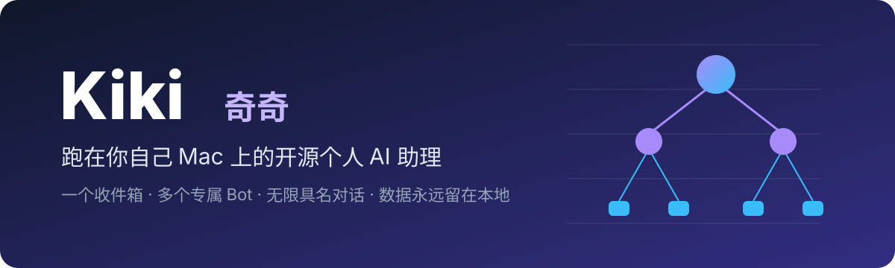
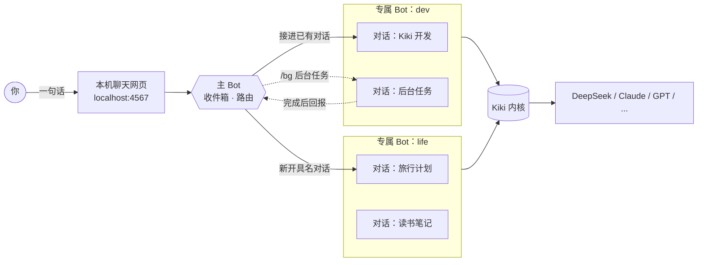

<div align="center">



<p>
  <a href="https://github.com/lkyxuan/kiki/stargazers"></a>
  <a href="https://github.com/lkyxuan/kiki/network/members"></a>
  <a href="https://github.com/lkyxuan/kiki/issues"></a>
  <a href="https://github.com/lkyxuan/kiki/commits/main"></a>
  <a href="LICENSE"></a>
</p>
<p>
  
  
  
  
</p>

**一个收件箱，多个专属 Bot，无限具名对话。你的数据永远留在你自己的机器上。**

[安装 Mac App](#-安装成-mac-app) · [快速开始](#-快速开始) · [核心特性](#-核心特性) · [架构](#️-架构) · [路线图](#️-路线图) · [参与贡献](#-参与贡献)

</div>

---

## 📖 简介

**Kiki（奇奇）** 是一个开源、本地优先的个人 AI 助理，专为常开的 Mac mini 设计。它借鉴了 Grok Bot 的交互：你只和一个**主 Bot** 说话，它像收件箱一样把每件事分派给对应的**专属 Bot**，每个专属 Bot 下面又按主题保存着多段**具名对话**。

和云端助理不同，Kiki 跑在你自己的电脑上：模型随你选，对话记录是本地文件，"关于我"和所有笔记都是普通 Markdown。哪天不想用 Kiki 了，带走文件夹就行。

Kiki 内核负责建对话、续对话、调用模型和工具，轻量、可扩展，随 Kiki 一起锁版本发布。

> [!NOTE]
> 项目处于早期阶段，已提供可一键安装、自动更新的 Mac App，欢迎 Star 关注进展。

## ✨ 核心特性

| | 特性 | 说明 |
|:---:|---|---|
| 📥 | **主 Bot 即收件箱** | 随手丢一句话，主 Bot 只负责分诊和转发，具体工作全部交给专属 Bot |
| 🤖 | **多个专属 Bot** | 开发、生活、学习……每个 Bot 一个文件夹、一份 `AGENTS.md`，新增 Bot 无需改代码、无需重启 |
| 💬 | **具名对话** | 每个 Bot 下可开多段有名字的对话，随时切换、随时续聊，上下文互不干扰 |
| ⚡ | **前台聊天，后台干活** | 讨论在对话里直接聊；真要干活就 `/bg` 丢到后台，完成后结果自动送回 |
| 🔒 | **本地优先** | 网页只监听 `127.0.0.1`；对话是 JSONL、资料是 Markdown，全部存在你的硬盘上 |
| 🔌 | **模型自由** | 默认 DeepSeek，Anthropic、OpenAI、Google 等主流模型改一行配置即可切换 |
| 🧩 | **可替换的外壳** | 编排层与数据彻底分离，界面、通道、模型都可以替换，不被任何一家锁定 |

## 🖼️ 界面预览

<div align="center">
  
  <p><sub>左侧是主 Bot 与各专属 Bot 的对话列表，右侧聊天，回答流式输出。</sub></p>
</div>

## 🏗️ 架构



**三层结构**

1. **主 Bot**：做得很薄。只判断一句话该接进哪段已有对话，还是在哪个 Bot 下新开一段，再把结果转回给你。
2. **专属 Bot**：`~/kiki-data/agents/<名字>/` 下的一个文件夹，`AGENTS.md` 写清楚它负责什么、怎么干、交回什么。
3. **具名对话**：Bot 下的 session，以 JSONL 格式保存在本地，可读、可备份、可迁移。

## 🍎 安装成 Mac App

推荐的用法：Kiki 装在常开的 Mac mini 上，你在 MacBook、iPhone 上远程用。在 Mac mini 的“终端”里跑一行：

```bash
curl -fsSL https://raw.githubusercontent.com/lkyxuan/kiki/main/packaging/install.sh | bash
```

- **开箱即用**：Kiki.app 自带运行环境和 Kiki 内核，不用另装 Node，登录后自动在后台启动，崩溃自动拉起。
- **自动更新**：有新版本时网页右上角会提示，默认在没有对话运行时自动安装，失败自动回滚。
- **安全远程**：Kiki 只监听本机，远程访问通过 [Tailscale](https://tailscale.com) 加密连接，只有你自己的设备能连上。

装好后编辑 `~/kiki-data/.env` 填入模型 API Key，再重启 Kiki 生效：`launchctl kickstart -k gui/$(id -u)/com.lkyxuan.kiki`。完整的安装、更新、远程使用和卸载说明见 **[Mac App 指南](docs/mac-app.md)**。

## 🚀 快速开始

想从源码运行或参与开发，按下面的步骤来。

### 环境要求

- macOS（推荐常开的 Mac mini）
- [Node.js](https://nodejs.org) 22.19 或以上：`brew install node`
- 一个模型 API Key（默认 [DeepSeek](https://platform.deepseek.com)）

### 安装与启动

```bash
git clone https://github.com/lkyxuan/kiki.git ~/kiki
cd ~/kiki
npm install
cp .env.example .env     # 填入模型的 API Key
npm start
```

打开 **<http://localhost:4567>** 即可开始对话。

第一次启动会自动在 `~/kiki-data` 生成数据目录（含 `dev`、`life` 两个示例 Bot），建议先编辑其中的 `AGENTS.md`，写下你希望每个 Bot 都知道的关于你的事。

> Kiki 内核随 `npm install` 一起装好，不需要单独安装。打包成 Mac App 时也会一起封进 `.app`，内核升级经测试后随 Kiki 版本发布。

### 配置项

| 变量 | 默认值 | 说明 |
|---|---|---|
| `DEEPSEEK_API_KEY` | — | 模型 API Key |
| `MODEL` | `deepseek/deepseek-flash` | 模型，格式 `provider/model` |
| `DATA_DIR` | `~/kiki-data` | 数据目录 |
| `DEFAULT_AGENT` | `life` | 未选择对话时，消息默认落到哪个 Bot |
| `PORT` | `4567` | 网页端口 |

## 💡 使用指南

在左侧点任意对话即可直接聊天；点 Bot 名旁的 **+** 新建对话。在主 Bot 里也可以用命令：

| 命令 | 作用 |
|---|---|
| `/new <bot> <名字>` | 在指定 Bot 下新开一段具名对话并切换过去 |
| `/use <名字>` | 切换到已有对话（重名时写 `bot/名字`） |
| `/list [bot]` | 列出全部或某个 Bot 的对话 |
| `/bg <任务>` | 在当前 Bot 下开一段后台对话执行任务，完成后自动回报 |
| `/agents` | 查看所有 Bot |
| `/where` | 查看当前所在的对话 |
| `/help` | 帮助 |

### 新增一个专属 Bot

```bash
mkdir -p ~/kiki-data/agents/study
$EDITOR ~/kiki-data/agents/study/AGENTS.md   # 写清楚：负责什么、怎么干、交回什么
```

刷新网页就能看到新 Bot，无需重启。

## 📂 数据目录

```text
~/kiki-data/
├── AGENTS.md              # 关于我：所有 Bot 共享
├── registry.json          # 对话名册：有哪些具名对话、各属于哪个 Bot
├── main.jsonl             # 主 Bot 的收件记录
└── agents/
    ├── dev/
    │   ├── AGENTS.md      # dev 的职责说明
    │   └── sessions/      # dev 的对话记录（JSONL）
    └── life/
        └── ...
```

建议把 `~/kiki-data` 纳入 Time Machine 或私有 Git 仓库备份。

## 🧩 推荐扩展

Kiki 内核兼容 pi 扩展生态。安装扩展需要先装 pi 命令行：

```bash
npm install -g @earendil-works/pi-coding-agent@1.4.0
```

| 扩展 | 作用 | 安装 |
|---|---|---|
| [pi-web-access](https://www.npmjs.com/package/pi-web-access) | 联网搜索、读取网页、PDF、GitHub 仓库 | `pi install npm:pi-web-access` |
| [cc-safety-net](https://ccsafetynet.com/docs/installation/pi) | 拦截 `rm -rf` 等危险命令与密钥文件读取 | 见[官方说明](https://ccsafetynet.com/docs/installation/pi) |

> [!WARNING]
> Bot 可以读写文件、执行命令，在你的电脑上拥有真实权限。强烈建议安装 cc-safety-net。

## 🗺️ 路线图

- [x] Kiki 内核：多 Bot、多具名对话
- [x] 后台任务与结果回报
- [x] 本机聊天网页（流式输出）
- [ ] 主 Bot 自动路由：用轻量模型判断该接哪段对话
- [ ] Kiki 自带扩展（`extensions/`）
- [x] Mac App：一键安装、开机自启、自动更新
- [x] 通过 Tailscale 安全远程使用
- [ ] 消息通道插件接口（微信等）
- [ ] 定时任务

## 🛠️ 技术栈

| 层 | 选型 |
|---|---|
| Agent 内核 | Kiki 内核，基于开源的 [pi](https://pi.dev) 1.4.0 构建 |
| 语言与运行时 | TypeScript · Node.js 22 |
| 界面 | 本机网页（SSE 流式输出），封装为 Mac App |
| 存储 | 本地文件：Markdown + JSONL，无数据库 |

<details>
<summary><b>代码结构</b></summary>

```text
src/
├── main.ts       # 入口：读取配置，连接网页、路由与内核
├── server.ts     # 本机网页与 API，也是未来接入其他通道的边界
├── router.ts     # 主 Bot：命令解析与分派
├── registry.ts   # 对话名册
└── agents.ts     # 内核封装：建对话、续对话、流式事件、读取历史
public/
└── index.html    # 聊天网页
```

```bash
npm test          # 运行测试
npm run check     # 类型检查
```

</details>

## 🤝 参与贡献

欢迎提交 Issue 和 Pull Request。

1. Fork 本仓库并新建分支：`git checkout -b feat/your-feature`
2. 提交前运行 `npm test` 和 `npm run check`
3. 发起 Pull Request，简要说明改动和动机

## 🙏 致谢

- [pi](https://pi.dev)：Kiki 内核所基于的开源 Agent 框架
- OpenClaw：session 工具设计的灵感来源
- Grok Bot：交互形态的灵感来源

## 📄 许可证

本项目基于 [MIT License](LICENSE) 开源。

## ⭐ Star 趋势

<a href="https://star-history.com/#lkyxuan/kiki&Date">
  <picture>
    <source media="(prefers-color-scheme: dark)" srcset="https://api.star-history.com/svg?repos=lkyxuan/kiki&type=Date&theme=dark">
    
  </picture>
</a>

<div align="center">

如果 Kiki 对你有帮助，请点一个 ⭐ 支持一下！

</div>
