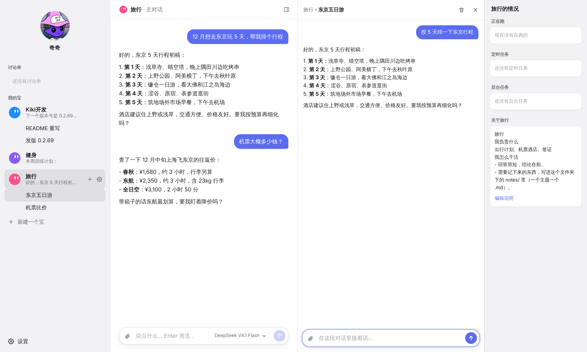
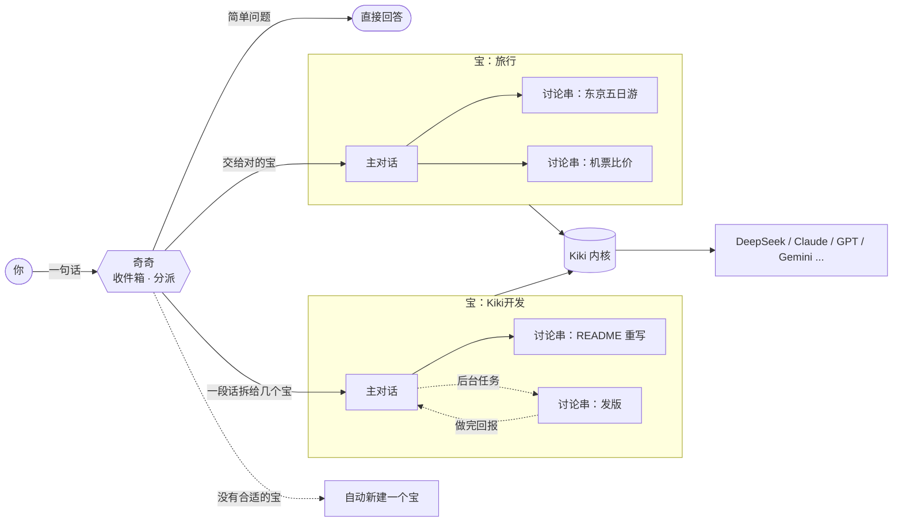

<div align="center">

**简体中文** · [English](README.en.md)

<picture>
  <source media="(prefers-color-scheme: dark)" srcset="docs/assets/banner-dark.svg">
  
</picture>

<p>
  <a href="https://github.com/lkyxuan/kiki/stargazers"></a>
  <a href="https://github.com/lkyxuan/kiki/releases"></a>
  <a href="LICENSE"></a>
  
  
  
</p>

**跟奇奇说一句，它替你分给对的宝。每个宝管一摊事，每件事一段对话。数据永远留在你自己的电脑上。**

[下载安装](#-下载安装) · [核心特性](#-核心特性) · [怎么用](#-怎么用) · [架构](#️-架构) · [路线图](#️-路线图) · [参与贡献](#-参与贡献)

</div>

---

## 📖 简介

**Kiki（奇奇）** 是一个开源、本地优先的个人 AI 助理，专为常开的 Mac mini 设计，打包成原生 Mac App。

你只需要跟**奇奇**说话。奇奇是你的收件箱：一句话能答完的直接回答；需要干活的，交给负责那摊事的**宝**；一段话里有好几件事，就拆开分给几个宝；没有合适的宝，就新建一个。每个宝有一段**主对话**，负责统筹，具体的事再开成**讨论串**，互不干扰。

和云端助理不同，Kiki 跑在你自己的电脑上：模型随你选，对话记录是本地文件，"关于我"和每个宝的说明都是普通 Markdown。哪天不想用 Kiki 了，带走文件夹就行。

<div align="center">
  <picture>
    <source media="(prefers-color-scheme: dark)" srcset="docs/assets/screenshot-dark.png">
    
  </picture>
  <p><sub>四栏界面：左边是奇奇和你的宝，中间是宝的主对话，右边打开讨论串，最右边是这个宝的情况。</sub></p>
</div>

## ✨ 核心特性

| | 特性 | 说明 |
|:---:|---|---|
| 📥 | **奇奇只做分派** | 随手丢一句话，奇奇判断交给哪个宝、接进哪段对话；简单问题直接答，一段话里几件事就拆开分 |
| 🤖 | **宝 = 一摊事** | 旅行、开发、健身……每个宝自带头像、主对话和说明，新建一个只要填名字和"负责什么" |
| 💬 | **主对话 + 讨论串** | 宝的主对话负责统筹，具体的事开成讨论串；对话里的卡片点开就在右栏看，还能接着说 |
| ⚡ | **前台聊，后台干** | 真要干活就丢到后台，做完回报到原对话；任务可排队、可重跑，重启不丢 |
| 🧠 | **会记事的宝** | 每段对话有一句话摘要；宝能看别的对话、给别的对话捎话，把要紧的事记进"关于我" |
| 🛡️ | **先问再动手** | 永久删除、强推、对外发送、花钱这四类收不回来的动作，做之前先问你一句 |
| 🖼️ | **看图、换模型** | 直接粘贴或拖进图片；输入框旁一键换模型，支持各家 API 密钥和订阅登录（ChatGPT、Claude、GitHub Copilot 等） |
| 🔒 | **本地优先** | 只监听本机，远程通过 Tailscale 加密访问；对话是 JSONL、资料是 Markdown，删掉的进回收站 |
| 🧩 | **可扩展** | 兼容 pi 扩展生态，设置里可加 MCP 服务器，格式和 Claude、Cursor 一样 |

## 📦 下载安装

推荐用法：Kiki 装在常开的 Mac mini 上，你在 MacBook、iPhone 上远程用。需要 macOS 12 或以上。

**方式一：终端一行安装**

```bash
curl -fsSL https://raw.githubusercontent.com/lkyxuan/kiki/main/packaging/install.sh | bash
```

**方式二：下载安装包**

到 [发布页](https://github.com/lkyxuan/kiki/releases/latest) 下载 `.dmg`（Apple 芯片选 arm64，Intel 选 x64），把 Kiki 拖进「应用程序」，**从「应用程序」里**打开。Kiki 还没有苹果签名，第一次打开会提示无法验证开发者：点「完成」，到「系统设置 → 隐私与安全性」拉到最下面点「仍要打开」。

装好后打开 Kiki，按引导在设置里填一个模型密钥就能开始聊。

- **开箱即用**：Kiki.app 自带运行环境和 Kiki 内核，登录后自动在后台启动，崩溃自动拉起。
- **自动更新**：每小时查一次新版本，空闲时自动安装，起不来就自动回滚。
- **多台设备**：其他 Mac 上装个 Kiki.app 选"连接远程地址"，只当界面用；iPhone 用浏览器加到主屏幕。
- **安全远程**：Kiki 只监听本机，远程通过 [Tailscale](https://tailscale.com) 加密连接，只有你自己的设备能连上。

完整说明见 **[Mac App 指南](docs/mac-app.md)**。

## 💡 怎么用

1. **跟奇奇说话**：比如"12 月想去东京玩 5 天"。奇奇会交给"旅行"宝（没有就新建一个），你在旅行的主对话里接着聊。
2. **指定宝**：用 `@宝名` 直接交给某个宝。
3. **开讨论串**：点宝旁边的 **+**，或让宝自己把新话题开成讨论串。讨论串在右栏打开，看完关掉回到总览。
4. **管理宝**：点宝旁边的齿轮，改名字、头像和"负责什么"；分派规则写在 `~/kiki-data/分派规则.md`，随时可改。

<details>
<summary><b>命令一览</b></summary>

| 命令 | 作用 |
|---|---|
| `@宝名 <内容>` | 直接交给某个宝 |
| `/new <宝> <名字>` | 在指定宝下新开一段讨论串 |
| `/use <名字>` | 切到已有对话（重名时写 `宝/名字`） |
| `/list [宝]` | 列出全部或某个宝的对话 |
| `/bg <任务>` | 交给后台去做，完成后回报到原对话 |
| `/tasks [all]` | 查看后台任务 |
| `/retry <任务id>` | 重跑失败或中断的任务 |
| `/run <任务id>` | 待办马上开始（定时任务就是马上多跑一次） |
| `/cancel <任务id>` | 取消待办、定时任务，或不做了的“等你回答”任务 |
| `/answer <任务id> <话>` | 回答卡住的后台任务（也可以直接在那段后台对话里回） |
| `/stop <任务id>` | 停下任务，正在跑的也能停 |
| `/revise <任务id> <话>` | 改任务：没开跑的改内容，在跑的插话，做完的在原对话里返工 |
| `/agents` | 查看所有宝 |
| `/where` | 查看当前在哪段对话 |
| `/help` | 帮助 |

**待办、定时和任务看板**

- 跟宝说“明天 9 点帮我…”“每个工作日早上整理…”“等 A 做完再做 B”“先记下，回头做”，它会用 `kiki_task` 记成待办或定时任务。到点、或者前一个任务做完，就自动开到后台去做，做完回报到原对话和奇奇。
- 后台任务缺了关键信息时会停在“等你”，奇奇里会出一条提醒；直接在那段后台对话里回一句，它就接着干。
- 每个任务可以带一行**完成标准**（做到什么算完），执行时会逐条对照。
- 想改一个已经派出去的任务，直接跟奇奇说（“周报里再加上下周计划”），它会认出是哪个任务，交给它改或者在原对话里返工。
- 任务做完还有后续要等（报了名等审核、下了单等发货），它会用 `kiki_watch` 记进关注清单，卡片上显示 👀。之后相关的邮件或消息进来，会回到这个任务原来的对话里接着办，需要你做什么会提醒你。
- 收发室派给外部 bot 的活也记成任务卡（卡上写着是谁在做），超时、重试、回报都和普通任务一样。
- 右栏“待办和定时”旁点 **看板**，按 待办 › 进行中 › 等你 › 完成 看所有任务，可以开始、取消、重跑。
- 时间支持：`+30m`、`21:00`、`明天 09:00`、`周五 18:00`、`下周一 10:00`、`2026-11-05 09:00`；重复支持：`每天 09:00`、`工作日 09:00`、`每周一 09:00`、`每小时`。

</details>

## 🏗️ 架构



**三层分派**

1. **奇奇**：做得很薄，只负责分诊和转发，自己不接具体的事。分派时参考每个宝"负责什么"和每段对话的一句话摘要。
2. **宝**：`~/kiki-data/agents/<宝名>/` 下的一个文件夹，`AGENTS.md` 写清楚它负责什么、怎么干活。每个宝有一段固定的主对话。
3. **讨论串**：宝下面的具体对话，以 JSONL 保存在本地，可读、可备份、可迁移。

## 📂 数据目录

```text
~/kiki-data/
├── AGENTS.md              # 关于我：所有宝共享
├── 分派规则.md             # 奇奇怎么分派，随时可改，不用重启
├── .env                   # 模型密钥等配置（只有你能读）
├── registry.json          # 对话名册和一句话摘要
├── tasks/                 # 后台任务：一个任务一个 .md
├── trash/                 # 回收站：删掉的讨论串在这里，不真删
├── engine/                # Kiki 内核的扩展和 MCP 配置
└── agents/
    ├── 奇奇/               # 默认的宝，负责分派
    └── 旅行/
        ├── AGENTS.md      # 旅行负责什么、怎么干活
        └── sessions/      # 主对话和讨论串（JSONL）
```

建议把 `~/kiki-data` 纳入 Time Machine 或私有 Git 仓库备份。

## 🗺️ 路线图

- [x] 奇奇分派：自动选宝、新建宝、一段话拆给多个宝
- [x] 宝的主对话 + 讨论串，四栏界面
- [x] 后台任务：排队、重跑、回报原对话
- [x] 对话摘要、跨对话捎话、交接
- [x] 全自动：删除和强推先自动备份、对外发送留撤回时间、花钱按预算，做完记下来一键撤回，不先问你
- [x] 看图、手动选模型、订阅登录
- [x] Mac App：一键安装、`.dmg`、自动更新、开场动画
- [x] 通过 Tailscale 安全远程使用，多台设备共用一个后台
- [ ] 待办、定时任务和任务看板 *（进行中）*
- [ ] 收发室：接入外部 Agent 和消息通道 *（进行中）*
- [ ] 苹果签名和公证

## 🚀 从源码运行

想参与开发，按下面的步骤来。需要 [Node.js](https://nodejs.org) 22.19 或以上。

```bash
git clone https://github.com/lkyxuan/kiki.git ~/kiki
cd ~/kiki
npm install
cp .env.example .env     # 填入模型的 API Key，也可以启动后在设置里填
npm start
```

打开 **<http://localhost:4567>** 即可开始对话。

<details>
<summary><b>配置项</b></summary>

这些写在 `~/kiki-data/.env`（源码运行时是仓库里的 `.env`），大部分也能在设置里改。

| 变量 | 默认值 | 说明 |
|---|---|---|
| `DEEPSEEK_API_KEY` | — | DeepSeek 密钥；其他服务商在设置里配置 |
| `MODEL` | `deepseek/deepseek-flash` | 默认模型，格式 `provider/model` |
| `SUMMARY_MODEL` | 同 `MODEL` | 写对话摘要、做分派用的模型，可以换便宜的 |
| `VISION_MODEL` | 自动挑 | 当前模型看不了图时，用它来读图 |
| `DATA_DIR` | `~/kiki-data` | 数据目录 |
| `DEFAULT_AGENT` | `奇奇` | 没选对话时，消息落到哪个宝 |
| `PORT` | `4567` | 网页端口 |
| `TASK_CONCURRENCY` | `2` | 后台任务最多同时跑几个 |
| `TASK_TIMEOUT_MIN` | `30` | 单个后台任务超时分钟数 |
| `KIKI_AUTO_UPDATE` | `1` | 设成 `0` 就不自动安装更新，只提示 |

</details>

<details>
<summary><b>扩展与 MCP</b></summary>

Kiki 内核兼容 pi 扩展生态，扩展装在 `~/kiki-data/engine`，和你电脑上另装的 pi 互不影响。可以在设置的「扩展」里装，也可以在仓库目录里运行：

```bash
npm run pi -- install npm:pi-web-access   # 联网搜索、读网页
npm run pi -- list                        # 看已装的扩展
```

MCP 服务器在设置的「MCP 服务器」里添加，格式和 Claude、Cursor 的 `mcpServers` 一样。

</details>

<details>
<summary><b>技术栈与代码结构</b></summary>

| 层 | 选型 |
|---|---|
| Agent 内核 | Kiki 内核，基于开源的 [pi](https://pi.dev) 1.4.0 构建 |
| 语言与运行时 | TypeScript · Node.js 22 |
| 界面 | 本机网页（SSE 流式输出），封装为 Mac App |
| 存储 | 本地文件：Markdown + JSONL，无数据库 |

```text
src/
├── main.ts       # 入口：读取配置，连接网页、路由与内核
├── server.ts     # 本机网页与 API
├── router.ts     # 奇奇：分派、命令、转发
├── route.ts      # 自动分派的判断逻辑
├── agents.ts     # 内核封装：建对话、续对话、流式事件
├── tasks.ts      # 后台任务
├── summary.ts    # 对话摘要
├── tools.ts      # 宝的工具：看别的对话、捎话、记事
├── approval.ts   # 全自动的兜底（备份、待发、预算）
├── backup.ts     # 先备份再动手、一键撤回
├── update.ts     # 自动更新
└── ...
public/           # 聊天界面、设置页、开场动画
packaging/        # Mac App 打包与安装脚本
```

```bash
npm test          # 运行测试
npm run check     # 类型检查
```

</details>

## 🤝 参与贡献

欢迎提交 Issue 和 Pull Request。

1. Fork 本仓库并新建分支：`git checkout -b feat/your-feature`
2. 提交前运行 `npm test` 和 `npm run check`
3. 发起 Pull Request，简要说明改动和动机

## 🙏 致谢

- [pi](https://pi.dev)：Kiki 内核所基于的开源 Agent 框架
- OpenClaw：后台任务和跨对话工具的设计灵感
- Hermes：自动更新和看图的设计灵感
- Grok Bot：交互形态的灵感来源

## 📄 许可证

本项目基于 [MIT License](LICENSE) 开源。

## ⭐ Star 趋势

<a href="https://star-history.com/#lkyxuan/kiki&Date">
  <picture>
    <source media="(prefers-color-scheme: dark)" srcset="https://api.star-history.com/svg?repos=lkyxuan/kiki&type=Date&theme=dark">
    
  </picture>
</a>

<div align="center">

如果 Kiki 对你有帮助，请点一个 ⭐ 支持一下！

</div>
