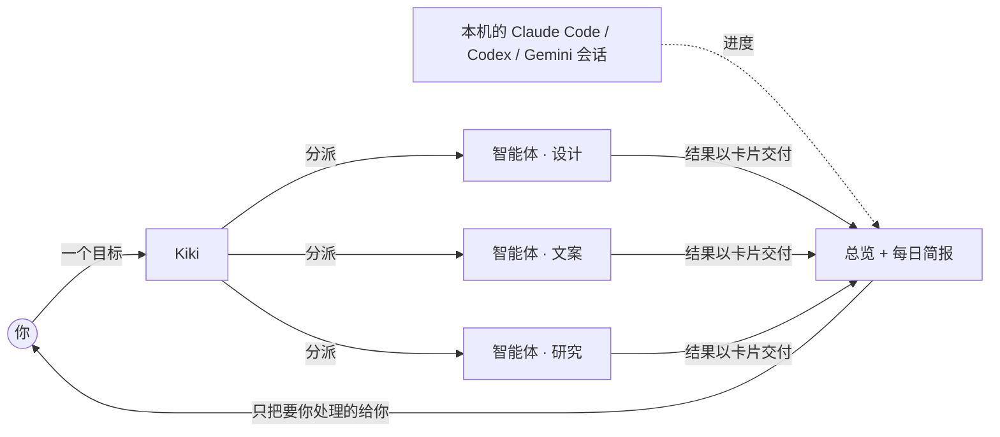
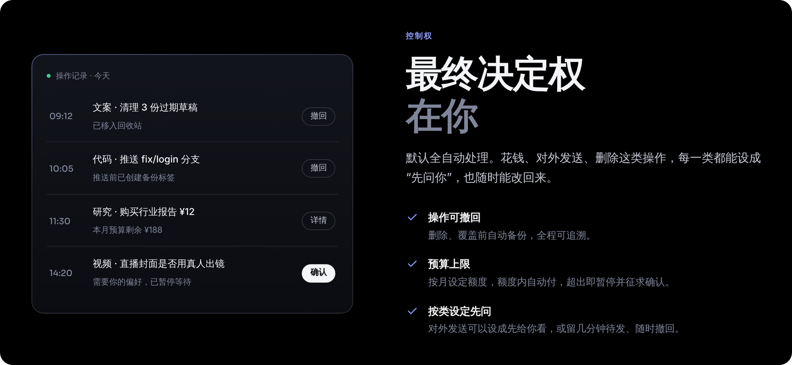

<div align="center">

[English](README.md) · **简体中文**

<a href="https://kikibao.com"></a>

<h3>你的个人 AI 团队，跑在你自己的 Mac 上。</h3>

<p>
  <a href="https://github.com/lkyxuan/kiki/releases/latest"></a>
  
  
  
  
  
</p>

[安装](#-安装) · [怎么工作](#-怎么工作) · [内核](#-内核) · [安全兜底](#-安全兜底) · [常见问题](#-常见问题) · [kikibao.com](https://kikibao.com)

</div>

```bash
curl -fsSL https://raw.githubusercontent.com/lkyxuan/kiki/main/packaging/install.sh | bash
```

## TL;DR

```yaml
kiki:
  是什么:      个人 AI 团队，不是聊天框
  跑在:        你自己的 Mac（推荐常开的 Mac mini）
  你给:        目标，用大白话说
  它做:        [拆解, 分派智能体, 多线并行, 跟进]
  找你:        [做完了, 要你拍板, 出错了]       # 其余时间不打扰
  内核:        [Kiki 内核(默认), Claude Code, DeepSeek Harness]  # 每个智能体单独选
  模型:        任意服务商，用你的密钥或订阅                      # 按用途单独选
  盯着:        你本机的 Claude Code / Codex / Gemini 会话
  数据:        你硬盘上的普通文件，不用注册云端账号
  绑定:        没有。带走文件夹就走。
```

## ⚡ 用起来是这样

```text
你   › 筹备下周三的产品发布会

Kiki › 拆成 3 条线，同时推进
       ├─ 设计   12 页发布会演示文稿      ▸ 进行中
       ├─ 文案   邀请函 + 新闻稿          ▸ 等你：抬头用“诚邀”还是“期待与您相见”？
       └─ 视频   直播流程单               ▸ 做完了 ✓

你   › 用“诚邀”

Kiki › 文案继续了。演示文稿好了我再告诉你。
```

别人常交给它的事：

```text
› 每天 8:00 生成 AI 行业简报
› 修复登录模块的缺陷并提交 PR
› 比价订好下周去东京的机票和酒店
› 让财务对一下 10 月账单，看有没有重复扣费
```

## 🧠 怎么工作



- **只有一个入口**：你只跟 Kiki 说话，它挑对的智能体、接进对的对话；一段话里有几件事就拆开分。在 Kiki 里，每个智能体叫一个“宝”。
- **一个智能体管一摊事**：各有自己的专长、记忆和工作规则。新建一个只要起名字、写一句“负责什么”。
- **默认在后台干**：长任务持续跑，定时任务自己触发，任务能排队、能重跑，重启不丢。
- **一处看全局**：Kiki 的智能体和你终端里的编程会话并排在总览里：哪件等你、哪条线在推进、刚发生了什么。
- **从你的修改里学**：你每次改动都会在夜里复盘，同一个问题出现三次就升级成所有智能体都遵守的规则，并写明出处。

## 🔩 内核

每个智能体选自己的内核，调度始终由 Kiki 负责。

| 内核 | 状态 | 适合 |
|---|---|---|
| **Kiki 内核** | 默认 | 启动快、能装扩展，DeepSeek、Kimi、通义千问、Anthropic、OpenAI 等都能接。基于开源 pi。 |
| **Claude Code** | 已支持 | 编程和长任务。直接跑真正的 Claude Code，用你自己的订阅，和终端里一样。 |
| **DeepSeek Harness** | 已支持 | DeepSeek 官方智能体框架。带界面的 DSH 插件直接在 Kiki 侧栏打开。 |

## 🔌 能接什么

| | |
|---|---|
| **编程 Agent** | Claude Code · Codex · Gemini · Cursor · Grok Bot。做完 / 等你批准 / 出错时提醒，点一下回到原会话。更多陆续接入。 |
| **模型服务商** | DeepSeek · Kimi · 通义千问 · Anthropic · OpenAI · Gemini · OpenRouter · xAI · Mistral，也能用 ChatGPT / Claude / GitHub Copilot 订阅登录。 |
| **扩展** | 设置里加 MCP 服务器，格式和 Claude、Cursor 一样。 |

按用途配模型，便宜的活交给便宜的模型：

```text
调度   → DeepSeek       低延迟
编程   → Claude Code    用你的账号
写作   → Kimi           中文写作
视觉   → 通义千问        图像理解
摘要   → DeepSeek       低成本
```

## 🛡 安全兜底

默认全自动，收不回来的操作都有兜底。

| 操作 | Kiki 怎么做 |
|---|---|
| 删除 / 覆盖 | 先备份，一键撤回，挪进回收站而不是 `rm` |
| 对外发送 | 直接发、先给你看，或留几分钟待发随时撤回（你来定） |
| 花钱 | 按月预算内自动付，超了就暂停问你 |
| 强推代码 | 推之前先打备份标签 |

<p align="center"></p>

## 🔒 你的数据

- 对话、记忆、配置都是 `~/kiki-data` 下的 Markdown 和 JSONL 文件，就在你的 Mac 上。
- 模型密钥只存在本机，不经过任何服务器。
- Kiki 只监听本机，远程访问走 [Tailscale](https://tailscale.com) 加密连接，只有你自己的设备连得上。
- 不想用了？带走文件夹就行，不用导出。

## 📦 安装

需要 macOS 13.5 及以上，支持 Apple 芯片和 Intel。

```bash
# 一行安装
curl -fsSL https://raw.githubusercontent.com/lkyxuan/kiki/main/packaging/install.sh | bash
```

或者下载安装包：[**Apple 芯片 .dmg**](https://dl.kikibao.com/latest/Kiki-mac-arm64.dmg) · [**Intel .dmg**](https://dl.kikibao.com/latest/Kiki-mac-x64.dmg) · [所有版本](https://github.com/lkyxuan/kiki/releases)

```text
1. 安装      把 Kiki 拖进「应用程序」，从那里打开
2. 邀请码    内测分批开放，第一次打开时填
3. 配模型    填任一服务商的密钥，或用订阅登录
4. 交代目标  其余交给 Kiki
```

- **自己更新**：每小时查一次，空闲时装，新版起不来自动回滚。
- **一直在线**：最好装在 Mac mini 上，MacBook 装个 Kiki.app 选远程模式，iPhone 用浏览器加到主屏幕。
- 提示“无法验证开发者”？系统设置 → 隐私与安全性 → 仍要打开。

## ⌨️ 快捷键

| 键 | 作用 |
|---|---|
| `⌘K` | 找智能体 |
| `⌘J` | 菜单 |
| `⌘,` | 设置 |
| `⇧⌘K` | 连接到别的 Kiki |

## ❓ 常见问题

<details>
<summary><b>和聊天式 AI 助手有什么不同？</b></summary>
<br>
聊天助手一次回答一个问题。Kiki 面向完整的任务：自动拆解、多线并行、后台持续运行，只在需要你决策时才通知你。
</details>

<details>
<summary><b>费用怎么算？</b></summary>
<br>
模型费用由你自己的模型服务商账号直接结算，Kiki 不经手。以 DeepSeek 为例，日常使用每月花费很低。
</details>

<details>
<summary><b>能和 Claude Code、Codex 一起用吗？</b></summary>
<br>
可以。本机会话会自动出现在总览里，做完、需要你确认或出错时提醒你。智能体也可以直接用 Claude Code 当内核。
</details>

<details>
<summary><b>开源吗？</b></summary>
<br>
不开源。这个仓库只用来发布安装包和收集反馈；之前在这里公开过的代码仍按当时的许可证使用，可以在提交历史里找到。
</details>

<details>
<summary><b>怎么拿内测邀请码？</b></summary>
<br>
内测名额分批开放，第一次打开 Kiki 时输入邀请码即可。
</details>

## 💬 反馈

遇到问题或想要什么功能：[提 Issue](https://github.com/lkyxuan/kiki/issues)。更新日志：[Releases](https://github.com/lkyxuan/kiki/releases)。

---

<sub>“Kiki”“奇奇”名称和 Kiki 图标是商标，经过签名的 Kiki 安装包只由官方发布。文中产品名称归各自所有者，仅用于说明 Kiki 可接入的产品。</sub>
